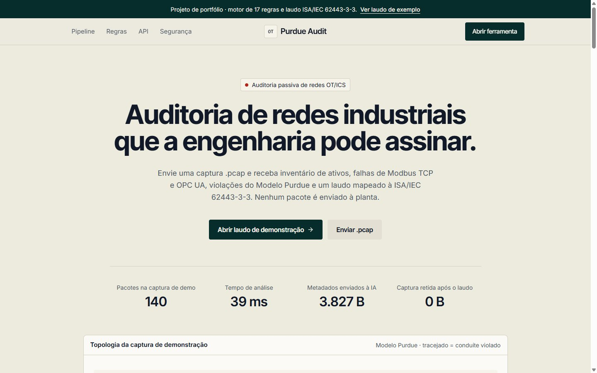
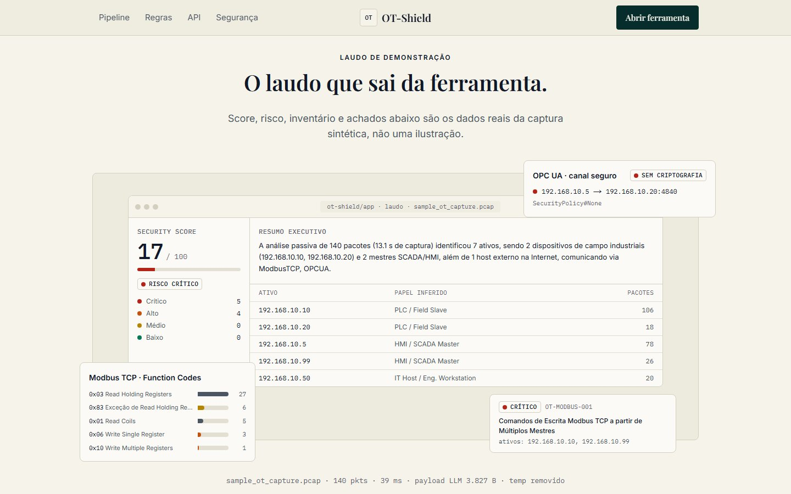
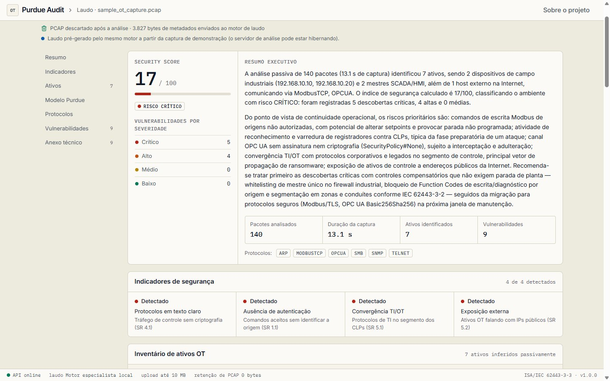
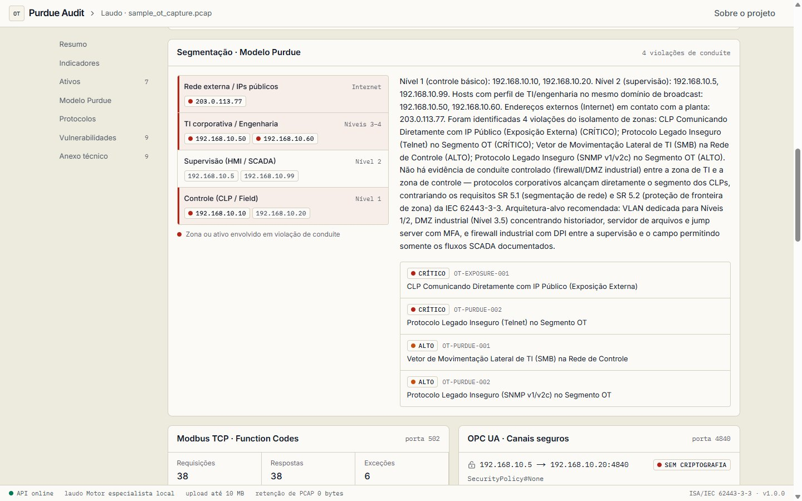
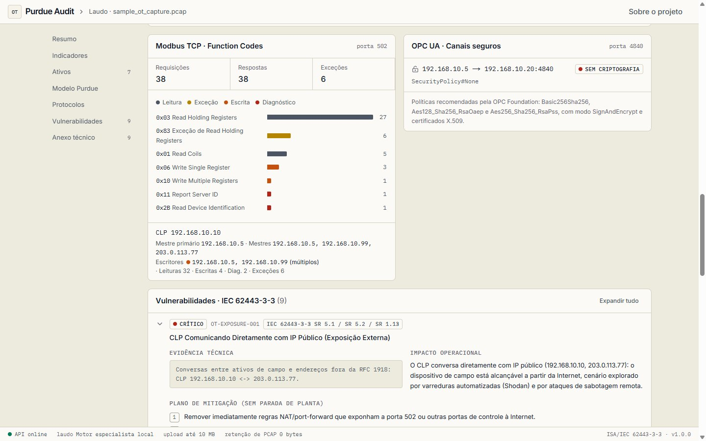
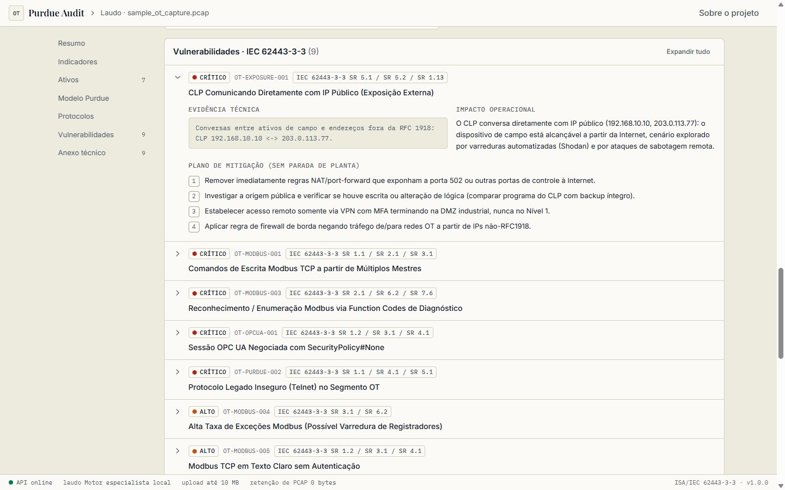
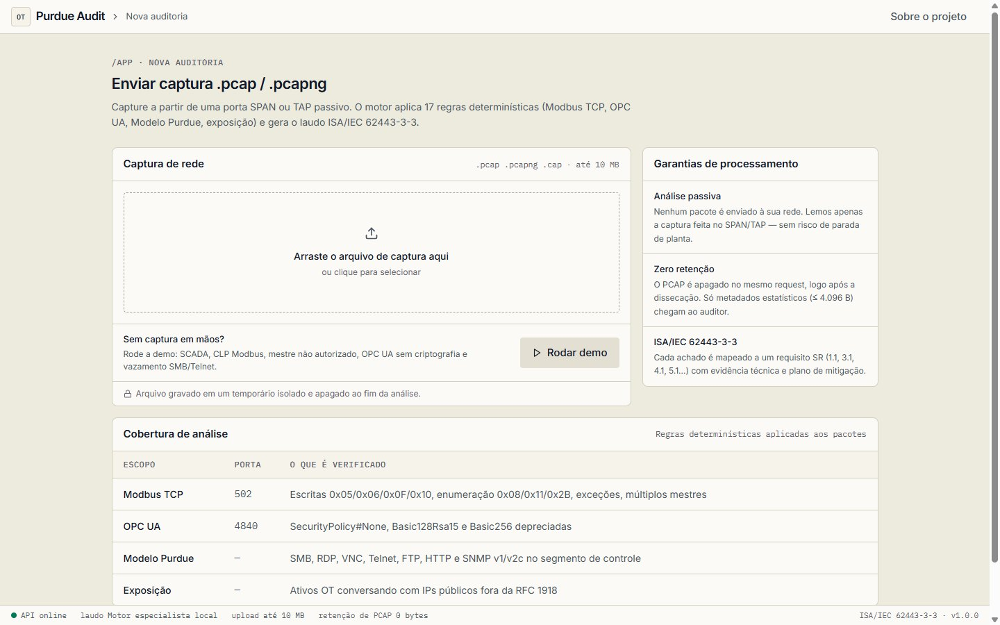
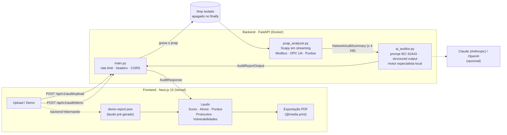

# OT-Shield AI

**Auditoria passiva de redes industriais (OT/ICS) a partir de capturas de tráfego, com laudo alinhado à ISA/IEC 62443-3-3.**

🔗 **Demonstração online:** [ot-shield-ai.vercel.app](https://ot-shield-ai.vercel.app) · [laudo de exemplo](https://ot-shield-ai.vercel.app/app?demo)

Envie um `.pcap` da rede de automação e receba, em segundos, um laudo técnico com:
- inventário de ativos (CLPs, SCADA/HMI, estações de engenharia);
- falhas de **Modbus TCP** e **OPC UA**;
- violações de segmentação do **Modelo Purdue**;
- plano de mitigação que não exige parada de planta.

> Projeto de portfólio, construído para unir automação industrial, cibersegurança OT e engenharia de software.
> A ferramenta é **estritamente passiva e defensiva**: nunca se conecta a redes ou CLPs reais, apenas lê
> capturas enviadas.



| Vitrine do laudo na landing | Laudo completo na ferramenta |
|---|---|
|  |  |

| Modelo Purdue | Protocolos industriais |
|---|---|
|  |  |

| Vulnerabilidades IEC 62443-3-3 | Envio de captura |
|---|---|
|  |  |

📄 **Exemplo de laudo exportado em PDF:** [`docs/laudo-exemplo.pdf`](docs/laudo-exemplo.pdf)

---

## O que o projeto demonstra

| Área | Como aparece no código |
|---|---|
| **Protocolos industriais** | Dissecação byte a byte do cabeçalho MBAP do Modbus TCP (vários ADUs por segmento TCP, Function Codes, respostas de exceção) e do `OpenSecureChannel` do OPC UA para extrair a `SecurityPolicyUri` |
| **Cibersegurança OT** | Regras mapeadas a requisitos SR da IEC 62443-3-3 e às zonas do Modelo Purdue: escrita por múltiplos mestres, enumeração de dispositivos, protocolos de TI no nível de controle, exposição à Internet |
| **IA aplicada** | O LLM recebe só um resumo estatístico de no máximo **4 KB** (nunca pacotes brutos); a resposta é validada por schema Pydantic (*structured output*) e há fallback para um motor especialista local determinístico |
| **Segurança da aplicação** | Processamento *stateless*, validação de assinatura do arquivo, limite de tamanho em streaming, rate limit por IP resistente a `X-Forwarded-For` forjado, CSP e container não-root |
| **Qualidade** | Type hints em 100% do Python, TypeScript estrito, testes automatizados com um PCAP sintético gerado pelo próprio projeto, CI no GitHub Actions |

## Interface

- **`/`**: página de apresentação (Next.js server components). As vitrines usam componentes reais alimentados pelo
  laudo de demonstração: topologia do Modelo Purdue em SVG, janela do laudo, histograma de Function Codes, canais
  OPC UA e exemplo de API.
- **`/app`**: a ferramenta. Upload ou demo, painel de progresso, laudo com navegação por seções e exportação em PDF.
- Responsiva (validada a 390 px por emulação de dispositivo), com animações respeitando `prefers-reduced-motion`.
- Design system próprio ([`DESIGN.md`](DESIGN.md) e [`design-system/SKILL.md`](design-system/SKILL.md)), com base no estilo
  Enterprise do TypeUI: superfícies areia, verde-petróleo, Playfair Display + Inter + IBM Plex Mono, cor reservada a
  severidade e acessibilidade WCAG 2.2 AA.

## Arquitetura



Fluxo de uma auditoria:
1. O arquivo chega em streaming e é gravado em um temporário isolado, respeitando o limite de tamanho.
2. Os 4 primeiros bytes são conferidos contra as assinaturas PCAP/PCAPNG.
3. O motor determinístico (Scapy) percorre a captura pacote a pacote e gera o `NetworkAuditSummary`.
4. O arquivo é **apagado no bloco `finally`**, com sucesso ou erro.
5. O resumo comprimido (≤ 4 KB) vai para o auditor (LLM ou motor local), que devolve o laudo validado por schema.

## Motor determinístico — `backend/app/services/pcap_analyzer.py`

| Domínio | Inspeção | Regras |
|---|---|---|
| **Inventário** | Agrupamento por IP/MAC; papel inferido pelas portas servidas e iniciadas (502, 4840, 102, 44818, 20000…) | `PLC / Field Slave`, `HMI / SCADA Master`, `Engineering Workstation / IT Host` |
| **Modbus TCP (502)** | MBAP byte a byte (Transaction ID, Protocol ID `0x0000`, Length, Unit ID) e Function Code | `OT-MODBUS-001` escrita de múltiplos mestres · `002` escrita fora do SCADA primário · `003` enumeração `0x08/0x11/0x2B` · `004` taxa de exceções (varredura) · `005` texto claro sem autenticação · `006` múltiplos mestres · `008` exceções esporádicas |
| **OPC UA (4840)** | Mensagens `HEL/ACK/OPN`; leitura da `SecurityPolicyUri` no OpenSecureChannel | `OT-OPCUA-001` `#None` · `002` `Basic128Rsa15`/`Basic256` (depreciadas) · `003` políticas seguras · `004` indeterminada |
| **Modelo Purdue** | Fluxos no segmento dos CLPs; versão do SNMP lida do cabeçalho BER | `OT-PURDUE-001` SMB/RDP/VNC · `002` Telnet/FTP/HTTP/SNMP v1-v2c |
| **Exposição** | IPs fora da RFC 1918 conversando com CLPs/SCADA | `OT-EXPOSURE-001` (CLP) · `002` (SCADA) |
| **ICS legado** | S7comm, DNP3, EtherNet/IP, IEC-104, BACnet | `OT-ICS-001` |

O score segue `100 · e^(−penalidade/80)`, com penalidades por severidade das descobertas.

## Segurança

| Camada | Controle |
|---|---|
| Dados da planta | PCAP apagado no `finally`; o LLM recebe ≤ 4 KB de estatísticas; nenhum laudo é persistido |
| Upload | Extensão e assinatura (magic number) validadas; limite de tamanho aplicado em streaming (`413`); captura corrompida → `422` sem deixar arquivo temporário |
| Borda | Rate limit por IP real (último salto do `X-Forwarded-For`, imune a IPs forjados à esquerda); CSP, `X-Frame-Options: DENY`, `nosniff`, `no-store`, HSTS em produção; `/docs` desligado em produção; CORS restrito |
| Container | Multi-stage slim, UID numérico não-root (10001), `HEALTHCHECK`, sem ferramentas de teste; `hadolint` limpo |
| Frontend | CSP com `connect-src` restrito à API; links externos só `https` com `noopener` |

## Rodando localmente

```bash
# Backend (Python 3.11+)
cd backend
python -m venv .venv && .venv/Scripts/activate        # Linux/macOS: source .venv/bin/activate
pip install -q -r requirements.txt
python -m app.utils.generate_sample_pcap               # gera a captura sintética de demonstração
uvicorn app.main:app --reload --port 8000              # docs em http://localhost:8000/docs
python -m pytest -q --tb=short                         # testes

# Frontend (Node 22+)
cd frontend
cp .env.example .env.local
npm install --silent --no-audit --no-fund
npm run dev                                            # http://localhost:3000
```

Sem chave de API, o laudo é gerado pelo **motor especialista local**, sem custo. Para usar o Claude, defina
`LLM_PROVIDER=anthropic` e `ANTHROPIC_API_KEY` em `backend/.env`.

Ou tudo com Docker: `docker compose up --build`.

### Rotas da API

| Método | Rota | Descrição |
|---|---|---|
| `GET` | `/api/v1/health` | Status, motor de laudo ativo e limite de upload |
| `POST` | `/api/v1/audit/upload` | `multipart/form-data` com `file` (.pcap/.pcapng) → `AuditResponse` |
| `POST` | `/api/v1/audit/demo` | Audita a captura sintética de demonstração |

### Laudo de demonstração pré-gerado

O frontend embute `frontend/public/demo-report.json`, gerado pelo mesmo endpoint de demo. Assim a demonstração
funciona mesmo quando o backend gratuito está hibernando, e o link `/app?demo` abre o laudo diretamente. Um teste
garante que o arquivo segue o contrato atual da API. Para regenerar:

```bash
cd backend && python -m app.utils.export_demo_report
```

## Deploy gratuito

1. **Frontend (Vercel):** importe o repositório com *Root Directory* = `frontend`. Variáveis:
   - `NEXT_PUBLIC_API_URL`: URL do backend;
   - opcionais: `NEXT_PUBLIC_AUTHOR_NAME`, `NEXT_PUBLIC_LINKEDIN_URL` e `NEXT_PUBLIC_REPO_URL`, exibidos no
     cabeçalho e em "Sobre o projeto".
2. **Backend (Render, opcional):** *New → Blueprint* com o `render.yaml`. Preencha `CORS_ORIGINS` com a URL da
   Vercel. O plano gratuito hiberna após inatividade; nesse caso a demo usa o laudo pré-gerado e o upload acorda
   o servidor em cerca de 1 minuto.

> Em um deploy público, mantenha `LLM_PROVIDER=mock`: o motor local gera o laudo sem custo de API e sem
> expor sua chave a abuso.

## Estrutura

```
├── backend/
│   ├── app/
│   │   ├── main.py                     # rotas, rate limit, upload stateless
│   │   ├── config.py · security.py
│   │   ├── models/schemas.py           # contratos Pydantic (Scapy ↔ LLM ↔ frontend)
│   │   ├── services/pcap_analyzer.py   # motor determinístico
│   │   ├── services/ai_auditor.py      # LLM + motor especialista local
│   │   └── utils/                      # captura sintética e exportador do laudo de demo
│   ├── tests/                          # pytest
│   └── Dockerfile
├── frontend/                           # Next.js 15 · TypeScript · Tailwind
├── docs/                               # especificações, capturas de tela e laudo em PDF
├── render.yaml · docker-compose.yml · .github/workflows/ci.yml
```

## Referências

- ISA/IEC 62443-3-2 (zonas e conduítes) e ISA/IEC 62443-3-3 (requisitos de segurança de sistema)
- Modbus Application Protocol Specification v1.1b3 e Modbus Messaging on TCP/IP Implementation Guide
- OPC UA Part 6 (Mappings): UA Connection Protocol e OpenSecureChannel
- Especificações internas: [`docs/01_PROTOCOL_PARSING_SPEC.md`](docs/01_PROTOCOL_PARSING_SPEC.md) ·
  [`docs/02_IEC62443_AI_SCHEMA.md`](docs/02_IEC62443_AI_SCHEMA.md)
